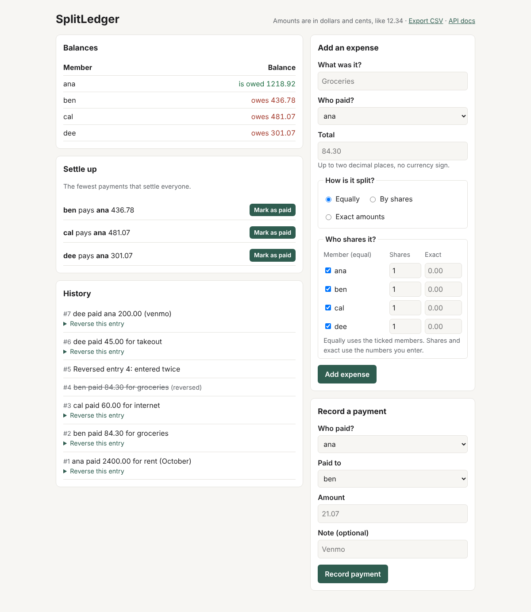
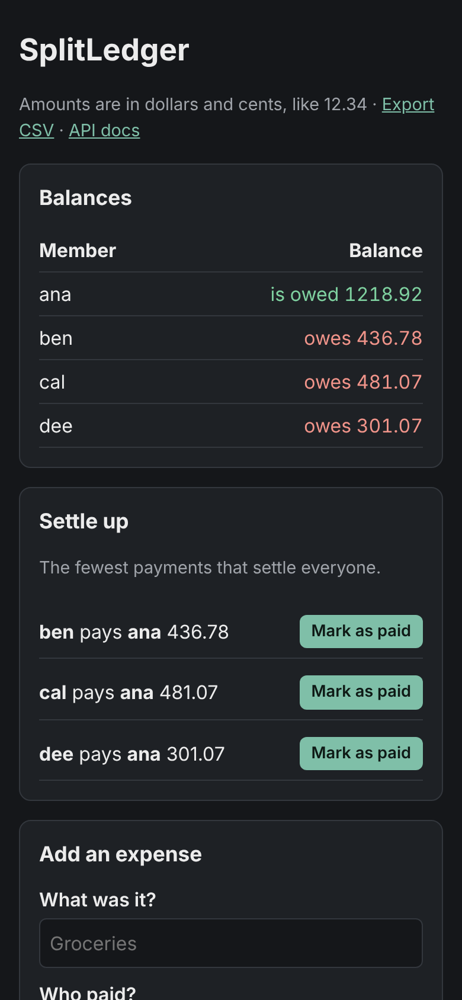
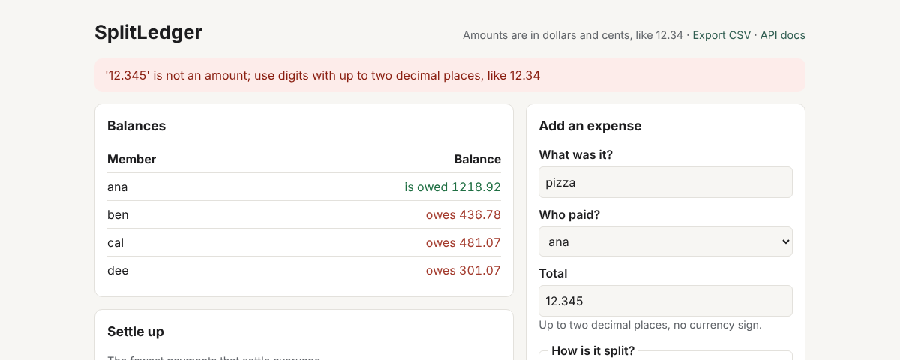

# SplitLedger

[](https://github.com/SohamMessi10/splitledger/actions/workflows/tests.yml)

A shared-expense tracker for a household: who paid, who it was for, and who owes whom,
**correct to the cent**. It runs on your own computer as a small web app backed by one SQLite
file, and suggests the fewest payments that settle everyone up.



## The problem

Roommates share rent, groceries, and bills. One person pays and several benefit, and after a
few weeks nobody is sure who owes what. Spreadsheets drift in quiet ways:

- **Cents go missing.** $10.00 split three ways is not 3 × $3.33. Something has to get the
  extra cent, every time, the same way.
- **Floating-point money is wrong.** In Python, `0.1 + 0.2 == 0.30000000000000004`, and those
  errors add up over a year of entries.
- **History gets overwritten.** Fixing a typo by editing a cell destroys the record of what
  happened.
- **Settling up takes too many payments.** With four people, the obvious approach often needs
  more transfers than necessary.

SplitLedger treats these as engineering requirements, and the tests prove each one.

## Demo: four roommates, one month

```bash
python examples/seed_demo.py demo.db
splitledger serve demo.db        # open http://127.0.0.1:8000
```

The demo household (all names and amounts are made up):

| # | Entry | How it's split |
|---|---|---|
| 1 | ana pays rent, 2400.00 | by shares: ana's larger room counts 2, everyone else 1 |
| 2 | ben pays groceries, 84.30 | equally among all four |
| 3 | cal pays internet, 60.00 | equally among ben, cal, dee (ana opted out) |
| 4 | ben enters the groceries again by mistake | equally |
| 5 | entry 4 is **reversed** ("entered twice"), not deleted | |
| 6 | dee pays takeout, 45.00 | exact amounts: cal 20.00, dee 25.00 |
| 7 | dee pays ana back 200.00 ("venmo") | |

Result: ana **is owed 1218.92**; ben owes 436.78, cal owes 481.07, dee owes 301.07. Those sum to
zero, as every set of balances must. Settling takes three payments: everyone pays ana.

Every balance can be explained line by line. Here is cal's statement:

```
   change   running  entry
  -480.00   -480.00  share of 'rent (October)' paid by ana: 480.00
   -21.07   -501.07  share of 'groceries' paid by ben: 21.07
    40.00   -461.07  paid 60.00 for 'internet', own share 20.00
   -21.07   -482.14  share of 'groceries' paid by ben: 21.07
    21.07   -461.07  reversal of entry 4 (entered twice): share of 'groceries' paid by ben: 21.07
   -20.00   -481.07  share of 'takeout' paid by dee: 20.00
```

On a phone, in dark mode, and with a validation error that keeps what was typed:

<p>
  
  
</p>

## Features

- **Three ways to split:** equally, by shares (2:1:1), or by exact amounts that must add up.
- **Payments between members**, with optional notes.
- **Corrections without erasing history:** a reversal cancels an entry and records why.
- **Settle up** with the fewest possible payments, plus a "Mark as paid" button for each.
- **CSV export** for spreadsheets, where the rows add up to the balances.
- **A JSON API** with interactive docs at `/docs`.
- **Safe storage:** one SQLite file per household, validated every time it's read.

## Setup

Requires Python 3.11 or newer. CI tests Python 3.11–3.14 on Linux and 3.13 on macOS.

```bash
git clone https://github.com/SohamMessi10/splitledger.git
cd splitledger
python3 -m venv .venv
source .venv/bin/activate
python -m pip install -e ".[dev]"
python -m pytest
```

The ledger core uses only the Python standard library. The web app is an optional extra
(`pip install -e ".[web]"`) built on FastAPI.

## Usage

```bash
splitledger init house.db ana ben cal dee     # create a household
splitledger serve house.db                    # web app on http://127.0.0.1:8000
splitledger export house.db ledger.csv        # spreadsheet export
```

### JSON API

Amounts are strings such as `"84.30"`, never JSON numbers, because a JSON number arrives in
Python as a float.

```bash
curl -X POST http://127.0.0.1:8000/api/expenses -H 'content-type: application/json' -d '{
  "description": "groceries", "payer": "ana", "amount": "84.30",
  "split": {"type": "equal", "members": ["ana", "ben", "cal", "dee"]}}'
```

```json
{"entry_id":1,"reversed":false,"kind":"expense","description":"groceries","payer":"ana","amount":"84.30","split":{"ana":"21.08","ben":"21.08","cal":"21.07","dee":"21.07"}}
```

| Method and path | Purpose |
|---|---|
| `GET /api/balances`, `/api/entries`, `/api/members` | Read the household |
| `GET /api/statement/{member}` | One member's balance, line by line |
| `GET /api/settlement` | Suggested payments, and whether they are provably the fewest |
| `POST /api/expenses` | Split `{type: "equal", members}`, `{type: "shares", shares}`, or `{type: "exact", amounts}` |
| `POST /api/reimbursements` | `{sender, receiver, amount, note}` |
| `POST /api/entries/{id}/reverse` | `{reason}` |
| `GET /export.csv` | CSV export |

Mistakes in a request are `422` with a readable message (`"payer 'zoe' is not a member of this
group"`), a missing entry is `404`, and a damaged database file is `500`.

## How it works

```
browser ──► FastAPI app (web.py)          HTML forms + JSON API, per-request SQLite connection
                │
                ▼
            LedgerStore (storage.py)      SQLite file: members, entries, shares
                │  replays every entry through the ledger's checks on load
                ▼
            Ledger (ledger.py)            expenses, payments, reversals → balances, statements
                │
     ┌──────────┼───────────────┐
 money.py    splits.py      settle.py     integer cents · exact splits · fewest payments
```

The core (`money`, `splits`, `ledger`, `settle`) is plain functions with no I/O, so every rule
is tested directly. Storage and the web app are thin layers on top.

## Design decisions

**Integer cents, strict parsing.** Every amount is an `int` number of cents. Text becomes cents
only through one strict parser: `"12.345"`, `"1,000"`, `"$5"`, and `"1e3"` are rejected rather
than guessed, so the user decides what they meant.

**Splits always add up.** Splitting uses the largest remainder method: everyone gets their exact
share rounded down, then the leftover cents go to whoever was closest to the next cent. Ties go
by member name, so the same expense always splits the same way, whatever order the names were
entered in.

**Balances are derived, never stored.** The database holds the history. Balances are recomputed
from it every time, so they can't drift out of sync and can always be explained line by line.

**Corrections are new entries.** A mistake is cancelled by a reversal that negates it, with a
required reason. Nothing is edited or deleted, which is how accounting ledgers keep an audit
trail. An entry can be reversed once, and the database enforces that with a `UNIQUE` constraint.

**Settling up: exact where it's affordable, and honest about it.** The fewest payments equals
the number of people with a balance minus the most groups they can be split into whose balances
each sum to zero. Finding that partition is NP-hard in general, but a household is small, so for
up to 12 people with a balance SplitLedger finds it exactly with dynamic programming over
subsets. Above that it falls back to a greedy method (at most n − 1 payments) and says so. The
tests include a case where greedy needs 4 payments and the exact method needs 3:

```python
>>> b = {"ana": -6000, "ben": -5000, "cal": 2000, "dee": 4000, "eli": 5000}
>>> [str(t) for t in settle_greedy(b)]
['ana pays cal 10.00', 'ana pays eli 50.00', 'ben pays cal 10.00', 'ben pays dee 40.00']
>>> [str(t) for t in settle(b).transfers]
['ana pays cal 20.00', 'ana pays dee 40.00', 'ben pays eli 50.00']
```

**Three layers of data integrity.** (1) The ledger validates every entry before it's written.
(2) The SQLite schema uses `STRICT` tables, `CHECK` constraints, and foreign keys, so impossible
rows are rejected even if someone edits the file with another tool. (3) Loading replays every
stored entry through the ledger's validation, which catches cross-row damage such as shares that
no longer add up.

**Safe schema upgrades.** Files carry a schema version. Opening an older file saves a backup,
then rebuilds the changed table using SQLite's documented ALTER TABLE procedure in one
transaction, and rolls back on any failure. The upgrade is tested on a real file written by the
previous version.

## Security

The app has no accounts, so it is built to be safe on one computer, not to be put online:

- It **listens only on 127.0.0.1**. `--host` accepts nothing else.
- It **rejects unexpected Host headers**, which blocks DNS rebinding (a malicious site pointing
  its own domain at 127.0.0.1 to reach your local app).
- It **refuses state-changing requests from other sites** (CSRF). Without this, any web page you
  visit could silently submit a fake expense to your local ledger. It also grants no CORS, so
  other sites' scripts can't read the responses.
- **Templates escape all text**, so a description like `<script>` is shown, not run.
- **The CSV export neutralizes formulas.** A description such as `=HYPERLINK(...)` would
  otherwise run when the file is opened in Excel (CSV injection).
- **Request bodies are strict:** unknown fields and wrong types are errors, not ignored.

## Testing

- **267 tests** (pytest) cover money parsing, splits, the ledger, settlement, storage,
  upgrades, CSV export, the web app, and the command line.
- **Property-based tests (Hypothesis)** generate random expenses and histories to check the
  invariants: splits add up, balances sum to zero, statements end at the balance, and suggested
  payments settle everyone. CI tries up to 1,000 random cases per property.
- **An independent check of the exact settlement:** it is compared with a brute force that tries
  every way to group up to 7 people.
- **Real conditions:** two writers in separate threads at the same time, a simulated disk failure
  mid-write, a hand-damaged database file, and a real browser at phone and desktop widths.
- **Mutation testing, by hand:** during development, each important rule was broken on purpose
  to confirm that some test failed. This isn't automated in CI.

What that turned up while building it:

- **Two infinite loops.** If unbalanced numbers got past the input check, both settlement
  methods would have looped forever. Both now stop with an error, and a regression test covers
  it.
- **Tests passing for the wrong reason.** Two tests turned out to be satisfied by a different
  rule than the one they claimed to check. Both were rewritten to isolate their rule.
- **Missing protections.** Three storage defenses (foreign keys on, never creating a file when
  opening, the write lock) had no test of their own until mutation testing showed it.
- **Web bugs found by running the real server:** a FastAPI dependency that was invisible because
  of where it was defined, and a SQLite connection used across threads. Both are fixed and tested.

### Performance (measured)

Balances are recomputed from the full history on every request, so cost grows with the number
of entries. Measured with synthetic histories (Python 3.13, SQLite 3.45, 2-CPU x86-64 Linux
workspace, median of 7 requests through the test client):

| Entries | Load and compute balances | `GET /api/balances` | `GET /` (page) |
|---:|---:|---:|---:|
| 100 | 0.7 ms | 3.1 ms | 4.1 ms |
| 1,000 | 9.4 ms | 11.1 ms | 12.3 ms |
| 10,000 | 80.8 ms | 74.4 ms | 128.9 ms |

Measuring found that each request replayed the history twice: once when opening the file and
again to answer. Removing the first replay cut `GET /api/balances` at 10,000 entries from 160 ms
to 74 ms. At an assumed 1,000 entries a year, a household would stay around 10 ms per request
for years.

## Limitations

- **One household per file and no accounts.** It's a local app; sharing it online would need
  authentication first.
- **Members are fixed** when the household is created.
- **One currency**, with no exchange rates.
- **Every request replays the whole history.** That's fine at household scale (see above), but a
  much larger ledger would need stored snapshots.
- **The history page lists every entry**, with no paging yet.
- **The exact settlement** covers up to 12 people with a balance; larger groups get the greedy
  method, which the app labels as not guaranteed to be the fewest payments.
- **CSV is export-only.** There's no import.

## Possible next steps

Adding and removing members, recurring expenses, paging the history, stored balance snapshots
for long histories, and authentication before any online use.

## License

[MIT](LICENSE)
